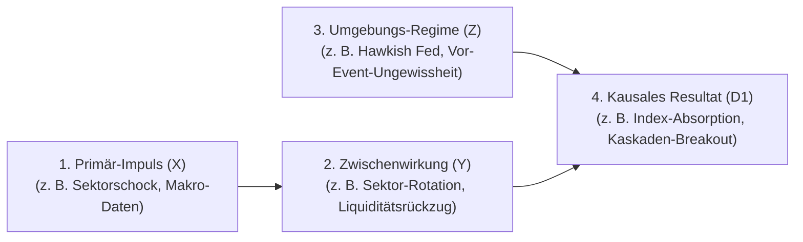

# Market Causal Patterns: Kausale Marktregeln & Verhaltensketten

Dieses Skill definiert die Methodik und den Standard zur Ableitung, Strukturierung und kontinuierlichen Bestätigung **allgemeingültiger, wiederverwendbarer Kausalketten** an den Finanzmärkten für das `newscheck`-Projekt.

---

## 1. Leitprinzip: Abstraktion statt Einzelfall-Fixierung

Regeln dürfen **niemals an ephemere Einmalereignisse oder Personen gekoppelt** sein:

| Negativ-Beispiel (Nicht wiederverwendbar) | Positiv-Beispiel (Allgemeingültige Kausalkette) |
| :--- | :--- |
| *„Wenn Jensen Huang bei Nvidia zurücktritt, steigt AMD.“* | **Idiosynkratischer Führungsschock bei einem Sektor-Schwergewicht ($X$)** $\rightarrow$ führt bei intakter Branchennachfrage zu **intra-sektoraler Substitution ($Y$)** in Peer-Substitute. |
| *„Wenn Trump auf Truth Social postet, fällt der Markt.“* | **Geopolitische Mahnung/Kommunikationsschock ($X$)** $\rightarrow$ dämpft vorzeitige Deeskalationshoffnungen ($Y$); im Umfeld angebotsseitiger Inflation ($Z$) führt dies zu **Risikoaufschlägen bei Energie & Zinsangst ($D_1$)**. |
| *„Am 10.11.2026 war der Markt bei 522 USD.“* | **Binäres Makro-Ungewissheitsregime ($Z$)** $\rightarrow$ induziert **Orderbuch-Rückzug und Volatilitätskompression** (Handelsspanne $< 0{,}8\,\%$, Volumen $< 70\,\%$). |

---

## 2. Die Kausalketten-Grammatik (Ursache-Wirkungs-Netzwerk)

Jede Regel wird als modularer Graph formuliert:



### Die vier Kettenglieder:
1. **Primär-Impuls $X$ (Sektor- oder Makro-Ebene):**
   * Welches fundamentale oder psychologische Ereignis ist eingetreten?
   * *Beispiele:* `IDIOSYNKRATISCHER_EINZELSCHOCK`, `MAKRO_INFLATIONSSPRUNG`, `GEOPOLITISCHER_ANGEBOTSSCHOCK`.
2. **Direkte Zwischenwirkung $Y$ (First-Order Effect):**
   * Wie reagiert das betroffene Marktsegment unmittelbar?
   * *Beispiele:* `INTRA_SEKTOR_SUBSTITUTION` (Kapital rotiert in Peers), `SEKTOR_KAPITALFLUCHT` (Kapital verlässt Sektor), `LIQUIDITAETS_FREEZE` (Orderbücher dünnen aus).
3. **Umgebungs- und Liquiditätsregime $Z$ (Moderator-Zustand):**
   * In welchem Makro- und Risikoumfeld trifft die Zwischenwirkung auf den Gesamtmarkt?
   * *Beispiele:* `MAKRO_ZINSDRUCK_HOCH`, `BINARE_EVENT_PARALYSE`, `LIQUIDITAETS_UEBERSCHUSS`.
4. **Resultierende Marktwirkung $D_n$ (Higher-Order Cascade):**
   * Was folgt zwingend aus der Kombination $(Y \land Z)$ für den Gesamtindex (z. B. DIA ETF)?
   * *Beispiele:* `INDEX_ABSORPTION_STABIL`, `KASKADIERENDER_ABVERKAUF`, `RELIEF_RALLY_COMPRESSION`.

---

## 3. OKF-Regelformat für Kausalketten (`okf-regeln/`)

Jede Datei in `okf-regeln/` folgt diesem standardisierten Schema:

```markdown
---
type: "Causal Behavioral Rule"
title: "OKF-Kausalregel: [Prägnanter Name des Musters]"
id: "regel-[name-des-musters]"
konfidenz: 0.85
kausal_schema:
  ursache_x:
    typ: "IDIOSYNKRATISCHER_EINZELSCHOCK"
    schwellenwert: "Einzelwert-Gewicht >= 10% im Sektor, Kursbewegung >= 4%"
  wirkung_y:
    typ: "INTRA_SEKTOR_ROTATION"
    effekt: "Peer-Werte steigen kompensatorisch"
  regime_z:
    typ: "BINARE_EVENT_PARALYSE"
    indikatoren: "Wichtige Makrodaten binnen 24-48h"
  resultat_d:
    index_reaktion: "neutral_stabil"
    volumen_signatur: "unterdurchschnittlich (< 0.75x)"
    spannen_kompression: "<= 1.0%"
sources:
  - id: "dia-market-data"
    description: "Daily OHLCV Marktdaten SPDR Dow Jones Industrial Average ETF (DIA)"
  - id: "news-briefings"
    description: "Morning Briefings Börse Stuttgart / Dow Jones Newswires"
tags:
  - kausalkette
  - behavioral-finance
  - sektor-rotation
---

# [Titel der Regel]

## 1. Kausale Wirkungskette
[Beschreibung der Kausalkette X -> Y und (Y + Z) -> D mit Mermaid-Diagramm]

## 2. Verhaltensökonomischer Mechanismus
[Warum handeln Akteure so? Welche kognitiven Verzerrungen oder Mandatsgrenzen treiben das Verhalten?]

## 3. Formale WENN-UND-DANN Matrix
* **WENN** [Impuls X im Sektor auftritt]
* **UND** [Zwischenwirkung Y beobachtet wird]
* **WÄHREND** [Makro-Zustand Z vorherrscht]
* **DANN:**
  1. [Auswirkung auf Gesamtindex DIA]
  2. [Volumensignatur]
  3. [Handlungsmaxime für Anleger / Systeme]

## 4. Empirisch prüfbare Signatur
* Quantitative Kriterien zur Validierung (Volumen-Ratio, Spanne in %, Richtungs-Neutralität).

## 5. Historische Fallbeispiele (Provenienz)
* *Beispiel A (KW 46 / 2026):* Nvidia CEO-Wechsel -> AMD/Broadcom Rallye -> DIA ruhig bei 0,38x Volumen.
* *Beispiel B:* [Weiteres historisches Fallbeispiel zur Bestätigung der Wiederverwendbarkeit].
```

---

## 4. Workflow bei jedem Newscheck-Lauf

Wenn Antigravity die tägliche Analyse durchführt (`Zelle 4`):

1. **Nachrichten abstrahieren:**
   * Konkrete Namen und Kurse in funktionale Rollen übersetzen (z. B. „Marktführer Sektor Tech“, „Zentralbank-Kommunikation“, „Pipeline-Inflation“).
2. **Kausalketten prüfen:**
   * Welche bestehende Regel aus `okf-regeln/` bildet die aktuelle Kausalkette ab?
   * Falls ein neues, reproduzierbares Marktphänomen vorliegt: Neue Kausalregel nach obigem Schema anlegen.
3. **Erwartung formulieren (`erwartung.md`):**
   * `bezugsregel` auf die primäre Kausalkette setzen.
   * Soll-Signatur (Richtung, Spanne relativ zum Vortagesschluss, Volumenprofil) aus der Kausalregel ableiten.
4. **Empirische Validierung (`Zelle 4.5`):**
   * Die Kettenglieder unabhängig von veralteten Preislevels prüfen.
   * Bei Bestätigung der Verhaltenssignatur: Konfidenz der Kausalregel stärken und in `validierung_historie.csv` archivieren.
