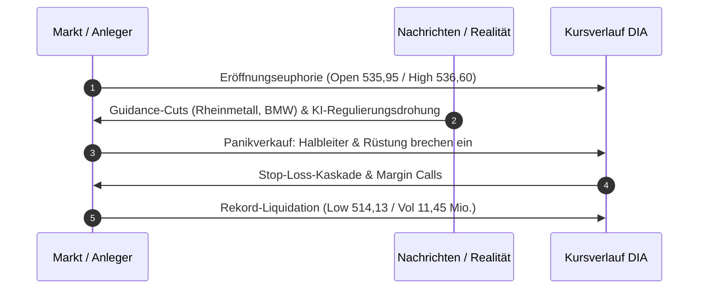

# Regel 3: Bull Trap, kaskadierender Realitätsschock und Panik-Liquidation

---

## 1. Verhaltensnarrativ & Empirischer Befund

Am Morgen des 05.11.2026 erreichte die post-elektoralen Euphorie ihren Höhepunkt, kippte jedoch binnen kürzester Zeit in blankes Entsetzen und panikartigen Ausverkauf um. 

Zwei fundamentale Belastungsfaktoren prallten frontal auf den Markt [^news-briefings-2026-11]:
1. **Regulatorischer Schock (KI & Tech-Infrastruktur)**: Die siegreichen Demokraten bereiten massive regulatorische Hürden für KI-Konzerne vor. Insbesondere der gigantische Ressourcenverbrauch von Rechenzentren (Wasserknappheit, exorbitanter Strombedarf) und lokale Belastungen geraten ins Visier. Zugleich geraten Unternehmen wie SpaceX und Tesla nach dem demokratischen Sieg im Bundesstaat Texas unter starken Druck.
2. **Reale Guidance-Kürzungen in der Industrie**: Rheinmetall kassiert trotz Rekordaufträgen Umsatz- und Margenziele wegen Projekt- und Abnahmeverzögerungen beim Boxer-Projekt "Arminius" und bei Artilleriemunition. BMW senkt die EBIT-Rendite im Autogeschäft drastisch auf -0,5 % bis +0,5 %. Im Halbleiterbereich enttäuschen Qualcomm und Arm Holdings.

### Empirischer Beleg am Markt (DIA-ETF)
* **Klassische Bull Trap am Morgen**: Eröffnung bei **535,95** und Anstieg auf das Periodenhoch von **536,60** [^dia-market-data].
* **Kollaps im Tagesverlauf**: Vertikaler Absturz um **22,47 Punkte** auf das Tagestief von **514,13**; Tagesschluss bei **514,27** (**-3,53 %** Tagesschluss, **-4,05 %** von Open zu Close) [^dia-market-data].
* **Kapitulationsvolumen**: Das Handelsvolumen explodiert auf **11.448.063 Anteile** – das **2,69-fache** des 10-Tages-Schnitts und das **4,9-fache** des Vortagsniveaus der Konsolidierungsphase [^dia-market-data].

---

## 2. Psychologische Mechanismen

1. **Plötzlicher Kognitionsbruch (Narrative Reversal)**: Wenn ein optimistisches Narrativ ("Gridlock schützt uns") durch harte Fakten (Gewinnwarnungen, Regulierungsinitiativen) widerlegt wird, kippt die kollektive Stimmung nicht schrittweise, sondern schlagartig.
2. **Kaskadierende Panik (Liquidation Cascade)**: Käufer, die während des Eröffnungs-Hypes oder am Vortag einstiegen, stehen sofort unter massivem Verlust. Der Zwang zur Verlustbegrenzung führt zu unlimitierten Market-Sell-Orders.
3. **Volumen-Klimax (Climax Selling)**: Ein Volumen von 11,45 Millionen Kontrakten zeigt, dass institutionelle Halter großvolumig Liquidität abzogen und Kleinanleger in Panik kapitulierte ("Capitulation Day").

---

## 3. Formale OKF-Regeldefinition

> ### Regel 3.1: Bull-Trap- und Panik-Kriterien
> * **WENN** ein Markt nach einer euphorischen Entlastungsphase auf neuem Hoch eröffnet,
> * **UND** im Vormittagshandel fundamentale Schockmeldungen (Guidance-Senkungen von Industrie-Leitwerten, Ankündigung regulatorischer Daumenschrauben) aufkommen,
> * **UND** der Leitindex intraday unter das Eröffnungsniveau des Vortags zurückfällt,
> * **DANN**:
>   1. Liegt eine vollendete Bull Trap (Bullen-Falle) vor.
>   2. Eskaliert der Abverkauf zu einem Climax-Tag mit Handelsvolumina von mehr als **250 % des 10-Tage-Durchschnitts**.
>   3. Ist das Tagestief des Abverkaufstages eine kritische Unterstützungszone, deren Bruch eine übergeordnete Baisse signalisiert.

---

## 4. Handlungsanweisungen für Anleger & Systeme

1. **Sofortiger Exit bei Fehlausbruch**: Fällt der Kurs nach Erreichen eines neuen Hochs unter das Tagestief der Relief Rally, sind Long-Positionen ohne Zögern glattzustellen.
2. **Kein verfrühtes „Auffangen fallender Messer“**: Niemals während der laufenden Intraday-Panik kaufen, selbst wenn vermeintlich günstige Kurse locken; der Tiefpunkt wird erst nach Erschöpfung des Kapitulationsvolumens ausgebildet.
3. **Fokus auf defensive Sektoren**: Bei regulatorischem Gegenwind für Wachstumssektoren (KI/Tech) fließt Liquidität temporär in krisenfeste Segmente ab.

---

## 5. Querverweise & Provenienz

* Vorherige Regel: [`regel-relief-rally-gridlock`](regel-relief-rally-gridlock.md)
* Folgeregel: [`regel-zinsangst-good-news-bad-news`](regel-zinsangst-good-news-bad-news.md)
* Folgephänomen: [`regel-sektordivergenz-bodenbildung`](regel-sektordivergenz-bodenbildung.md)
* Empirische Daten: [`marktdaten-analyse-dia`](marktdaten-analyse-dia.md)
* Übergeordnete Synthese: [`synthese-verhaltensregeln`](synthese-verhaltensregeln.md)

[^dia-market-data]: Marktdaten-Auszug DJIA/DIA vom 26.10. bis 06.11.2026.
[^news-briefings-2026-11]: Morning Briefings der Börse Stuttgart / Dow Jones Newswires vom 05.11.2026.
