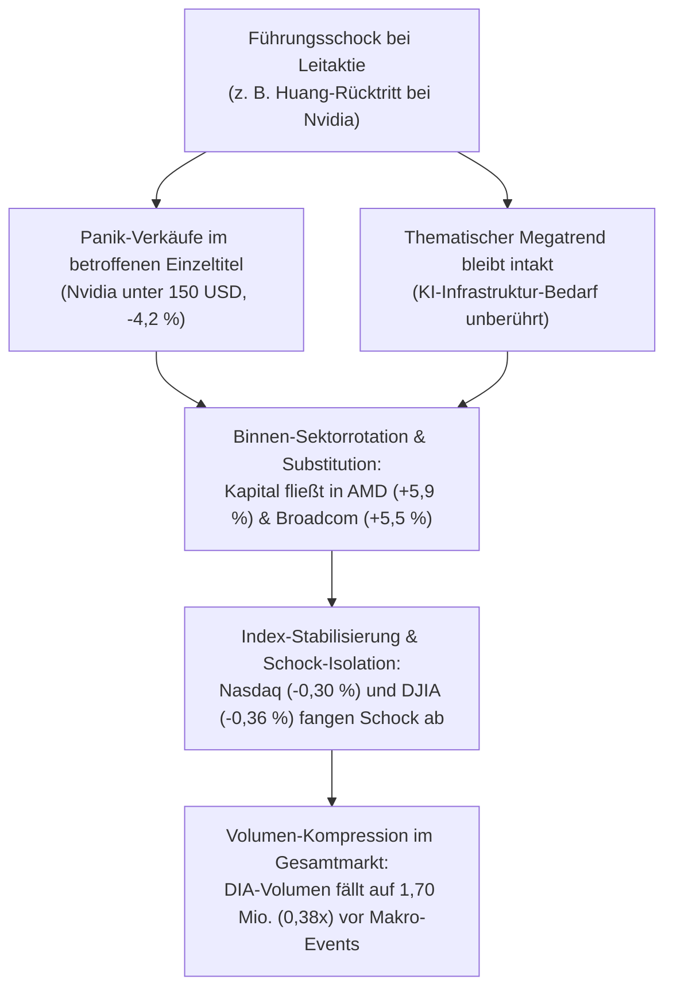

# Regel 6: Idiosynkratischer Key-Person-Schock und Binnen-Sektorrotation

---

## 1. Verhaltensnarrativ & Empirischer Befund

Am 12.11.2026 erschütterte der überraschende Rücktritt des langjährigen Nvidia-Vorstandschefs Jensen Huang nach persönlichen Affären die globalen Technologiemärkte [^news-briefings-2026-11]. Huang galt als die zentrale Integrationsfigur und das weltweite Aushängeschild des KI-Infrastruktur-Booms.

In einer klassischen Marktpanik hätte ein solcher Führungsschock bei der weltweiten Leitaktie zu einer unkontrollierten Liquidationswelle über alle Indizes hinweg führen können. Stattdessen zeigte sich ein differenziertes Verhaltensmuster:
1. **Isolierte Einzelwert-Kapitulation**: Die Nvidia-Aktie brach im Frühhandel zweistellig ein, fiel unter 150 USD und schloss mit -4,2 % (ein Einbruch um fast ein Drittel vom Allzeithoch) [^news-briefings-2026-11].
2. **Aggressive Binnen-Sektorrotation (Substitutionsheuristik)**: Marktteilnehmer interpretierten das Ereignis nicht als Ende des strukturellen KI-Hardwarezyklus, sondern als unternehmensspezifisches Governance-Problem. Frei werdendes Kapital wurde unmittelbar in direkte Wettbewerber umgeschichtet: AMD legte um +5,9 % zu, Broadcom um +5,5 % [^news-briefings-2026-11]. Zudem stützten Mega-Caps (Amazon, Alphabet, Microsoft) und Tesla (+2,1 %) die Indizes.
3. **Ausdünnung des Gesamtmarkt-Handelsvolumens**: Während in Halbleitertiteln hektisch umgeschichtet wurde, zogen sich institutionelle Akteure im Gesamtmarkt zurück. Der Dow Jones Industrial gab moderat um -0,36 % nach (DIA: -0,38 % auf 522,47) [^dia-market-data]. Das Handelsvolumen des DIA sank dabei auf ein extremes Jahrestief von **1.702.339 Anteilen** (nur 0,38x des 10-Tages-Durchschnitts von 4,48 Mio.) [^dia-market-data].

---

## 2. Psychologische Mechanismen

1. **Kausale Attribution (Idiosynkratisch vs. Systemisch)**: Anleger trennen rasch zwischen personengebundenen Risiken (Governance, Fehlverhalten) und makroökonomischer Nachfrage. Weil der KI-Investitionsbedarf der Hyperscaler (Microsoft, Meta, Google) vertraglich gebunden ist, wird kein Nachfragekollaps, sondern eine Marktanteilsverschiebung antizipiert.
2. **Heuristik der sektoralen Substitution**: Portfoliomanager mit Benchmark-Bindung an den Halbleiter- und Tech-Sektor können ihre Tech-Quote nicht schlagartig in Cash umwandeln. Sie substituieren den geschwächten Marktführer unverzüglich durch die nächsten Peers (AMD, Broadcom).
3. **Wait-and-See-Schockstarre im Gesamtmarkt**: Außerhalb des betroffenen Subsektors meiden Marktteilnehmer neue Risikoallokationen, bis Klarheit über die neue Führungsstruktur und die anstehenden Quartalszahlen herrscht (Nvidia Q3-Bericht am 17.11.2026 [^termine-preview]). Dies führt zu einer drastischen Liquiditätsabnahme im breiten Index (Volumendürre).

---

## 3. Formale OKF-Regeldefinition

> ### Regel 6.1: Schock-Substitutions- und Volumendynamik
> * **WENN** ein dominanter Branchenprimus ("Market Darling") einen abrupten, personellen oder Governance-bedingten Einzelschock erleidet,
> * **UND** der fundamentale Branchentrend durch das Ereignis nicht tangiert wird,
> * **DANN**:
>   1. Führt dies zu einer sofortigen sektoralen Kapitalumschichtung in direkte Peer-Unternehmen mit Kursgewinnen von >5 % bei den Konkurrenten.
>   2. Verbleibt der übergeordnete Leitindex (DJIA/DIA) in einer moderaten Konsolidierungsspanne (<0,5 % Tagesverlust), da Umschichtungseffekte den Einbruch absorbieren.
>   3. Kollabiert das Handelsvolumen des breiten Leit-ETFs auf unter 50 % des 10-Tages-Durchschnitts, da Fonds bis zur nächsten fundamentalen Bestätigung (z. B. Quartalszahlen) abwarten.

---

## 4. Handlungsanweisungen für Anleger & automatisierte Systeme

1. **Keine Short-Positionen auf den Gesamtmarkt**: Ein personeller Einzelschock beim Marktführer rechtfertigt keinen pauschalen Index-Short. Der Schock wird intraday durch Sektor-Rotationsgewinne abgefedert.
2. **Pairs-Trading & Relative-Value-Strategien**: Long-Allokationen in Substituten (AMD, Broadcom) gegen selektive Hedges im geschwächten Primus bieten das beste Chance-Risiko-Verhältnis.
3. **Erkennung von Liquiditäts-Fallen**: Das extrem niedrige Volumen im Leitindex (1,70 Mio. Anteile) signalisiert, dass Preisbewegungen vorübergehend fragil und anfällig für Gap-Risiken bei nachfolgenden Makrodaten (z. B. US-Erzeugerpreise) sind.

---

## 5. Querverweise & Provenienz

* Empirische Datenbasis: [`marktdaten-analyse-dia`](marktdaten-analyse-dia.md)
* Verwandte Regel: [`regel-sektordivergenz-bodenbildung`](regel-sektordivergenz-bodenbildung.md)
* Vorläufer-Paralyse: [`regel-pre-event-paralyse`](regel-pre-event-paralyse.md)
* Übergeordnete Synthese: [`synthese-verhaltensregeln`](synthese-verhaltensregeln.md)
* Prognoseanwendung: [`erwartung`](../erwartung.md)

[^dia-market-data]: Datensatz SPDR Dow Jones Industrial Average ETF Trust (DIA), 10-Tages-Zeitreihe Daily OHLCV vom 30.10.2026 bis 12.11.2026.
[^news-briefings-2026-11]: Morning Briefings und Schlusspanels der Börse Stuttgart / Dow Jones Newswires vom 09.11.2026 bis 13.11.2026.
[^termine-preview]: Wochenvorschau Termine bis 20. November 2026 (`termine.md`).
