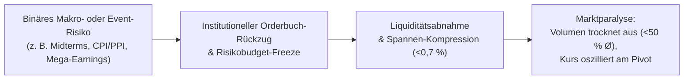

# Regel 1: Vor-Ereignis-Paralyse und Volatilitätskompression (Pre-Event Stance)

---

## 1. Verhaltensnarrativ & Empirischer Befund

In den Handelstagen unmittelbar vor binären Großereignissen – wie den US-Zwischenwahlen (Midterms) oder entscheidenden Inflationsveröffentlichungen (US-CPI / US-PPI) – dominiert in den Finanzberichten das Narrativ des **„Abwartens und der Zurückhaltung“** [^news-briefings-2026-11]. Institutionelle Marktteilnehmer meiden neue Richtungsrisiken, was die Orderbücher ausdünnt.

### Empirischer Beleg am Markt (DIA-ETF)
1. **Wahltag (03.11.2026)**:
   * Eröffnung bei **517,06**, Tagesschluss exakt bei **517,06** (0,00 % Nettoveränderung) [^dia-market-data].
   * Die Handelsspanne betrug lediglich **3,19 Punkte (0,62 %)** bei gedämpften **3.177.824 Anteilen** [^dia-market-data].
2. **Vor-CPI-Kompression (10.11.2026)**:
   * Vor und unmittelbar nach Veröffentlichung der US-Verbraucherpreise (14:30 MEZ) erstarrte die Handelsaktivität in einer Spanne von nur **3,41 Punkten (0,65 %)** (Low 519,19 / High 522,60, Close 521,73) [^dia-market-data].
3. **Vor-PPI- und Pre-Earnings-Dürre (12.11.2026)**:
   * Nach dem personellen Nvidia-Schock und vor den anstehenden US-Erzeugerpreisen (PPI am 13.11. [^termine-preview]) sowie den Nvidia-Q3-Zahlen (17.11.) kollabierte das Handelsvolumen auf **1.702.339 Anteile** (nur 0,38x des 10-Tages-Durchschnitts von 4,48 Mio.) [^dia-market-data].

---

## 2. Psychologische Mechanismen

1. **Entscheidungsaufschub unter Mehrdeutigkeit (Ambiguity Aversion)**: Fondsmanager und Market Maker fürchten asymmetrische Verluste bei unklaren Event-Ausgängen. Risikobudgets werden vorab eingefroren.
2. **Volatilitätsunterdrückung durch Liquiditätsrückzug**: Da aktive institutionelle Richtungsorders fehlen, bestimmen überwiegend passive Zuflüsse und Rebalancing das Geschehen. Die realisierte Volatilität fällt künstlich ab.
3. **Kognitive Ruhe vor dem Sturm**: Marktteilnehmer wiegen sich fälschlicherweise in Sicherheit, da geringe Preisschwankungen als Marktstabilität fehlinterpretiert werden.

---

## 3. Formale OKF-Regeldefinition

> ### Regel 1.1: Bedingungs- und Handlungsmatrix
> * **WENN** ein binäres makroökonomisches Großereignis (CPI, PPI, Fed-Entscheid) binnen 24–48 Stunden ansteht,
> * **UND** in den Marktberichten verminderte institutionelle Aktivität ("Abwarten", "Zurückhaltung") konstatiert wird,
> * **DANN**:
>   1. Schlägt sich dies in einer Verengung der täglichen Handelsspanne auf unter 0,7 % des Indexwerts nieder.
>   2. Trocknet das Spot-Volumen auf unter 70 % (bei akkumulierter Unsicherheit sogar unter 40 %) des 10-Tages-Durchschnitts ab.
>   3. Ist jeglicher scheinbare Trendausbruch vor Veröffentlichung der Daten mit hoher Wahrscheinlichkeit ein Fehlausbruch (Fakeout).

---

## 4. Handlungsanweisungen für Anleger & Systeme

1. **Kein prozyklisches Trading**: Keine Breakout-Strategien bei unterdurchschnittlichem Volumen handeln.
2. **Keine Absicherungsauflösung**: Absicherungen (Puts, Hedges) dürfen nicht vor dem Event liquidiert werden.
3. **Vorbereitung auf Volatilitätsexpansion**: Die künstliche Volatilitätskompression entlädt sich nach dem Event typischerweise in Form eines signifikanten Eröffnungs- oder Nachmittags-Gaps.
4. **Tagesaktuelle Anwendung**: Gilt vor den US-Erzeugerpreisen (PPI) am 13.11.2026 [^termine-preview] und vor den Nvidia-Earnings am 17.11.2026.

---

## 5. Querverweise & Provenienz

* Verwandte Analyse: [`marktdaten-analyse-dia`](marktdaten-analyse-dia.md)
* Folgeregeln: [`regel-relief-rally-gridlock`](regel-relief-rally-gridlock.md), [`regel-idiosynkratischer-schock-rotation`](regel-idiosynkratischer-schock-rotation.md)
* Übergeordnete Synthese: [`synthese-verhaltensregeln`](synthese-verhaltensregeln.md)
* Prognoseanwendung: [`erwartung`](../erwartung.md)

[^dia-market-data]: Datensatz SPDR Dow Jones Industrial Average ETF Trust (DIA), 10-Tages-Zeitreihe Daily OHLCV vom 30.10.2026 bis 12.11.2026.
[^news-briefings-2026-11]: Morning Briefings der Börse Stuttgart / Dow Jones Newswires vom 02.11. bis 13.11.2026.
[^termine-preview]: Wochenvorschau Termine bis 20. November 2026 (`termine.md`).

> Korrektur: 2026-11-13 03:57 Soll-Ist-Abweichung (0/3 Treffer) – Regel hinterfragt.
