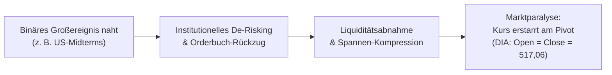

# Regel 1: Vor-Ereignis-Paralyse und Volatilitätskompression (Pre-Event Stance)

---

## 1. Verhaltensnarrativ & Empirischer Befund

In den Handelstagen unmittelbar vor binären Großereignissen – wie den US-Zwischenwahlen (Midterms) am 03.11.2026 – dominiert in den Finanzberichten das Narrativ des **„Abwartens und der Zurückhaltung“** [^news-briefings-2026-11]. Institutionelle Marktteilnehmer verzichten auf neue Positionsaufbauten, um unkalkulierbare Richtungsrisiken zu vermeiden.

### Empirischer Beleg am Markt (DIA-ETF)
* Am 03.11.2026 eröffnete der DIA-ETF bei **517,06** und schloss unverändert bei exakt **517,06** (0,00 % Nettoveränderung) [^dia-market-data].
* Die Handelsspanne betrug lediglich **3,19 Punkte (0,62 %)**, das Volumen lag bei gedämpften **3.177.824 Anteilen** [^dia-market-data].
* Bereits am Vortag (02.11.) zeigte sich eine verhaltene Spanne bei rückläufigem Handelsvolumen [^dia-market-data].

---

## 2. Psychologische Mechanismen

1. **Entscheidungsaufschub unter Mehrdeutigkeit (Ambiguity Aversion)**: Fondsmanager und Market Maker fürchten asymmetrische Verluste bei unklaren Wahlausgängen. Risikobudgets werden vorab eingefroren.
2. **Volatilitätsunterdrückung durch Liquiditätsrückzug**: Da institutionelle Orders fehlen, bestimmen überwiegend passive Zuflüsse und Rebalancing das Geschehen. Die realisierte Volatilität fällt künstlich ab, während die implizite Volatilität im Optionsmarkt ansteigt.
3. **Kognitive Ruhe vor dem Sturm**: Marktteilnehmer wiegen sich fälschlicherweise in Sicherheit, da geringe Preisschwankungen als Marktstabilität fehlinterpretiert werden.

---

## 3. Formale OKF-Regeldefinition

> ### Regel 1.1: Bedingungs- und Handlungsmatrix
> * **WENN** ein binäres makroökonomisches oder politisches Großereignis binnen 24–48 Stunden ansteht,
> * **UND** in den Marktberichten verminderte institutionelle Aktivität ("Abwarten", "Zurückhaltung") konstatiert wird,
> * **DANN**:
>   1. Schlägt sich dies in einer Verengung der täglichen Handelsspanne auf unter 0,7 % des Indexwerts nieder.
>   2. Trocknet das Spot-Volumen auf unter 80 % des 10-Tages-Durchschnitts ab.
>   3. Ist jeglicher scheinbare Trendausbruch mit hoher Wahrscheinlichkeit ein Fehlausbruch (Fakeout).

---

## 4. Handlungsanweisungen für Anleger & Systeme

1. **Kein prozyklisches Trading**: Keine Breakout-Strategien bei unterdurchschnittlichem Volumen handeln.
2. **Keine Absicherungsauflösung**: Absicherungen (Puts, Hedges) dürfen nicht vor dem Event liquidiert werden, selbst wenn die Bewegung bis zum Vortagsschluss scheinbar stagniert.
3. **Vorbereitung auf Volatilitätsexpansion**: Die künstliche Volatilitätskompression entlädt sich am Folgetag typischerweise in Form eines signifikanten Eröffnungs-Gaps (siehe [`regel-relief-rally-gridlock`](regel-relief-rally-gridlock.md)).

---

## 5. Querverweise & Provenienz

* Verwandte Analyse: [`marktdaten-analyse-dia`](marktdaten-analyse-dia.md)
* Folgeregel: [`regel-relief-rally-gridlock`](regel-relief-rally-gridlock.md)
* Übergeordnete Synthese: [`synthese-verhaltensregeln`](synthese-verhaltensregeln.md)

[^dia-market-data]: Marktdaten-Auszug DJIA/DIA vom 26.10. bis 06.11.2026.
[^news-briefings-2026-11]: Morning Briefings der Börse Stuttgart / Dow Jones Newswires vom 02.11. und 03.11.2026.
