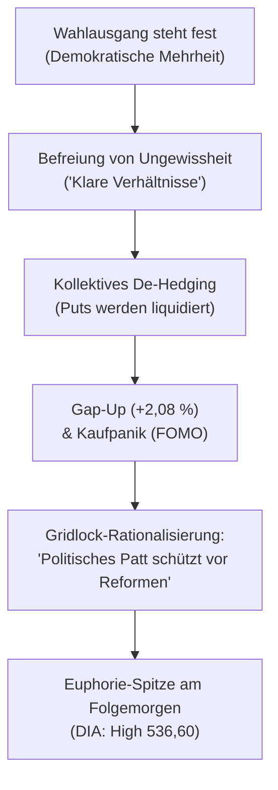

# Regel 2: Post-Event Relief Rally und Gridlock-Illusion

---

## 1. Verhaltensnarrativ & Empirischer Befund

Sobald das Ergebnis der US-Kongresswahlen feststand (überraschender Sieg der Demokraten in Senat und Repräsentantenhaus), vollzog das Marktsentiment am 04.11.2026 eine 180-Grad-Wende. In den Nachrichten dominierte das Narrativ von **„klaren Verhältnissen“** und der **„Befreiung von Ungewissheit“** [^news-briefings-2026-11]. Trotz der offensichtlichen Regierungserschwerung für Präsident Trump wurde das Wahlergebnis als positiv interpretiert, gestützt durch sinkende Ölpreise und nachgebende Renditen [^news-briefings-2026-11].

### Empirischer Beleg am Markt (DIA-ETF)
* **Aggressives Eröffnungs-Gap**: Am 04.11.2026 eröffnete der DIA bei **527,81** gegenüber dem Vortagsschluss von 517,06 – ein Kurssprung von **+2,08 %** über Nacht [^dia-market-data].
* **Dynamische Trendfortsetzung**: Der Kurs stieg weiter bis zum Tageshoch von **534,28** und schloss bei **533,11** (**+3,10 %** Tagesplus) [^dia-market-data].
* **Volumenexpansion**: Das Handelsvolumen verdoppelte sich schlagartig auf **6.599.418 Anteile** (+108 % gegenüber dem Vortag) [^dia-market-data].

---

## 2. Psychologische Mechanismen

1. **Ungewissheitsprämien-Kompensation (Certainty Relief)**: Die Börse verabscheut nichts mehr als Ungewissheit. Sobald ein Ergebnis unverrückbar feststeht, preisen die Märkte sofort die zuvor eingepreiste Risikoprämie aus – unabhängig davon, ob das Ergebnis fundamental vorteilhaft ist.
2. **De-Hedging-Kaskade**: Marktteilnehmer schließen massenhaft vorab gekaufte Absicherungen (Puts). Market Maker müssen im Gegenzug ihre Short-Delta-Absicherungen über den Kassamarkt eindecken, was einen mechanischen Kaufdruck entfaltet.
3. **Die Gridlock-Illusion (Confirmation Bias)**: Marktbeobachter rechtfertigen die Kursgewinne reflexartig mit dem klassischen Narrativ des „Divided Government“: Ein Kongress der Gegenpartei lähme radikale Gesetzesvorhaben, was die Wirtschaft schütze. Die akute Gefahr gezielter Blockaden, parlamentarischer Untersuchungen und regulatorischer Interventionen wird in dieser Phase vollkommen ausgeblendet.

---

## 3. Formale OKF-Regeldefinition

> ### Regel 2.1: Relief- und Gridlock-Mechanik
> * **WENN** ein binäres Großereignis entschieden ist und in den Berichten das Narrativ „Befreiungsschlag / Klare Verhältnisse / Politischer Stillstand schützt die Wirtschaft“ vorherrscht,
> * **UND** der Markt mit einem Eröffnungs-Gap von über +1,5 % bei stark steigendem Volumen (> 140 % des 10-Tages-Mittels) reagiert,
> * **DANN**:
>   1. Handelt es sich um eine mechanisch getriebene De-Hedging-Rallye, keine fundierte Neubewertung.
>   2. Besitzt diese Entlastungsrallye eine typische Halbwertszeit von **12 bis 36 Handelsstunden**.
>   3. Ist die Wahrscheinlichkeit eines Fehlausbruchs (Bull Trap) am Folgehandelstag signifikant erhöht, sobald reale regulatorische oder fundamentale Implikationen verarbeitet werden (siehe [`regel-bull-trap-realitaetsschock`](regel-bull-trap-realitaetsschock.md)).

---

## 4. Handlungsanweisungen für Anleger & Systeme

1. **Absicherungen schließen, aber Gewinne zügig realisieren**: Pre-Event-Hedges sofort am Eröffnungstag auflösen; aufgelaufene Kursgewinne aus Long-Positionen in die Rallye hinein sukzessive teilrealisieren.
2. **Keine späten FOMO-Zukäufe**: Niemals am Nachmittag des Relief-Tages oder am Folgemorgen auf neuen Höchstständen Positionen aggressiv aufstocken.
3. **Trailing Stops nachziehen**: Stoppkurse eng unter das Tagestief des Rallye-Tages nachziehen, um sich gegen den unvermeidlichen Realitätscheck abzusichern.

---

## 5. Querverweise & Provenienz

* Vorherige Regel: [`regel-pre-event-paralyse`](regel-pre-event-paralyse.md)
* Folgeregel: [`regel-bull-trap-realitaetsschock`](regel-bull-trap-realitaetsschock.md)
* Empirische Daten: [`marktdaten-analyse-dia`](marktdaten-analyse-dia.md)
* Übergeordnete Synthese: [`synthese-verhaltensregeln`](synthese-verhaltensregeln.md)

[^dia-market-data]: Marktdaten-Auszug DJIA/DIA vom 26.10. bis 06.11.2026.
[^news-briefings-2026-11]: Morning Briefings der Börse Stuttgart / Dow Jones Newswires vom 04.11.2026.
