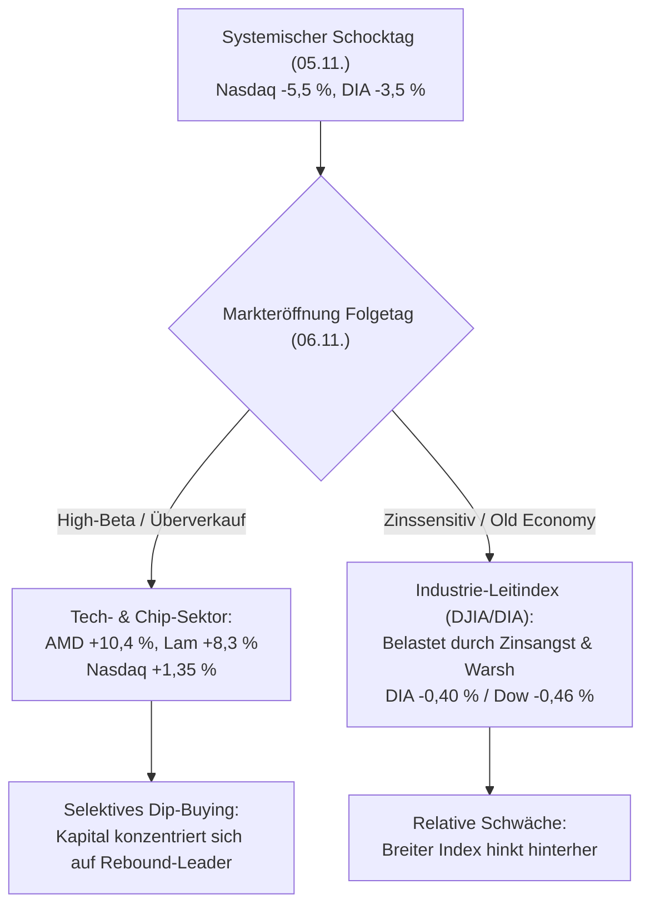

# Regel 5: Asymmetrische Panik-Absorption und selektives Dip-Buying

---

## 1. Verhaltensnarrativ & Empirischer Befund

Nach dem dramatischen Ausverkauf am 05.11.2026 zeigte sich am Handelstag des 06.11.2026 eine markante **Sektordivergenz**: Während die Panik im Technologiesektor am Vortag am heftigsten wütete (-5,5 % im Nasdaq Composite), griffen dort unmittelbar nach Börsenöffnung am Freitag professionelle Schnäppchenjäger zu [^news-briefings-2026-11]. 

* **Selektive Erholungsrallye im Tech-Sektor**:
  * Halbleiter- und KI-Leitwerte schossen zweistellig nach oben: AMD legte um **+10,36 %** zu, Lam Research um **+8,25 %**, Intel um **+7,24 %** und Nvidia um **+3,18 %** [^news-briefings-2026-11].
  * Von demokratischen Wahlerfolgen in Texas gebeutelte Werte wie SpaceX (**+9,35 %**) und Tesla (**+4,81 %**) erholten sich signifikant [^news-briefings-2026-11].
  * Der Nasdaq 100 gewann **+1,35 %** auf 26.989 Punkte [^news-briefings-2026-11].
* **Trägheit und Nachzügler-Verluste im DJIA**:
  * Der Dow Jones Industrial Average verzeichnete weitere Verluste von **-0,46 %** auf 51.285 Zähler [^news-briefings-2026-11].
  * Der DIA-ETF schloss bei **512,22** nach einem Eröffnungstief von 508,66, blieb aber im Minus gegenüber dem Vortag [^dia-market-data].
  * Strategen (z. B. Mark Haefele, UBS) beruhigten Großanleger mit dem Narrativ: *„Der KI-Investitionszyklus ist weiterhin intakt... Fundamentaldaten rechtfertigen keinen anhaltenden Abschwung“* [^news-briefings-2026-11].

---

## 2. Psychologische Mechanismen

1. **Selektive Schnäppchenjagd (Anchoring & Bargain Hunting)**: Nach einem massiven Preisrutsch verankern sich Marktteilnehmer an den früheren Höchstständen. Bei strukturellen Zukunftsthemen (KI, Halbleiter) führt dieser Ankereffekt zu aggressiven Einstiegen auf ermäßigtem Niveau ("Buy the Dip").
2. **Asymmetrische Risikoabsorption**: Während im Tech-Sektor die Zuversicht in langfristiges Gewinnwachstum den kurzfristigen Schock überlagert, fehlen im Industrie- und Autosektor (geprägt durch Realeinschnitte bei Rheinmetall und BMW) solche Wachstumserzählungen.
3. **Liquiditäts-Kannibalisierung**: In Erholungsphasen nach Paniktagen fließt spekulatives Erholungskapital vorzugsweise in die volatilsten Gewinnerwerte mit dem höchsten Beta. Der breite Standardwerte-Index (DJIA) wird liquiditätsmäßig vernachlässigt.

---

## 3. Formale OKF-Regeldefinition

> ### Regel 5.1: Sektordivergenz und Rebound-Hierarchie
> * **WENN** auf einen panischen Gesamtmarktabverkauf (> 3 % Verlust im Leitindex unter Spitzenvolumen) ein Folgetag mit verhaltener Stabilisierung folgt,
> * **UND** Analysten das übergeordnete Makronarrativ (z. B. „Investitionszyklus intakt“) verteidigen,
> * **DANN**:
>   1. Bilden die am Vortag am stärksten abgestraften Technologiewerte den ersten und dynamischsten Erholungssektor aus.
>   2. Reagiert der DJIA/DIA unterproportional träge und kann sogar weitere Verluste verbuchen, da Zinsängste und Gewinnrevisionen den traditionellen Sektor belasten.
>   3. Ist der Kauf des breiten Index (DIA) zur Rebound-Partizipation sub-optimal gegenüber der gezielten Selektion überverkaufter Einzeltitel.

---

## 4. Handlungsanweisungen für Anleger & Systeme

1. **Rebound-Trades selektiv allokieren**: Nach einem Paniktag das Rebound-Kapital nicht in den Gesamtmarkt-ETF (DIA) streuen, sondern in die liquidesten Outperformer des abgestraften Leitthemas (Halbleiter-Schwergewichte).
2. **Geduld bei Industrie- und Konsumwerten**: Im DJIA abwarten, bis die Zinsdebatte der Notenbank (Fed) sich beruhigt und Gewinnwarnungen vollständig eskomptiert sind.
3. **Risikomanagement bei Dip-Käufen**: Enge Stop-Loss-Marken knapp unter den Tagestiefs des Paniktages platzieren.

---

## 5. Querverweise & Provenienz

* Vorherige Regel: [`regel-zinsangst-good-news-bad-news`](regel-zinsangst-good-news-bad-news.md)
* Ursprungsschock: [`regel-bull-trap-realitaetsschock`](regel-bull-trap-realitaetsschock.md)
* Empirische Daten: [`marktdaten-analyse-dia`](marktdaten-analyse-dia.md)
* Übergeordnete Synthese: [`synthese-verhaltensregeln`](synthese-verhaltensregeln.md)

[^dia-market-data]: Marktdaten-Auszug DJIA/DIA vom 26.10. bis 06.11.2026.
[^news-briefings-2026-11]: Morning Briefings und Schlusspanels der Börse Stuttgart / Dow Jones Newswires vom 06.11. und 07.11.2026.
