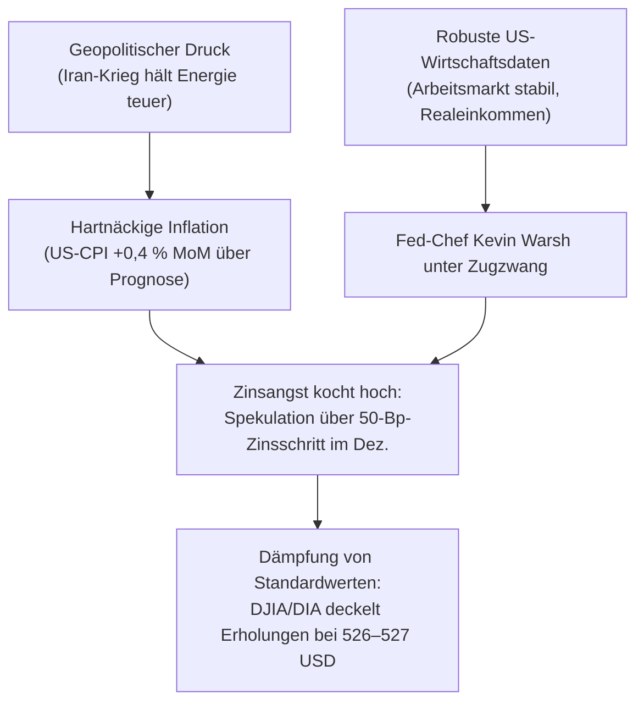

# Regel 4: Zinsangst und das „Good News is Bad News“-Dilemma

---

## 1. Verhaltensnarrativ & Empirischer Befund

Am 06.11.2026 und erneut am 10.11.2026 zeigte sich an den Finanzmärkten das klassische Dilemma der geldpolitischen Restriktion [^news-briefings-2026-11]:
1. **Arbeitsmarktdaten (06.11.)**: Robuste Beschäftigungszahlen (+59.000 Stellen ex Agrar, Arbeitslosenquote 4,2 %) und ein starkes Verbrauchervertrauen beflügelten nicht die Märkte, sondern nährten die Befürchtung, Fed-Chef Kevin Warsh werde die Zinsen im Dezember weiter anheben.
2. **CPI-Inflationsschock (10.11.)**: Die US-Verbraucherpreise stiegen im Monatsvergleich um **+0,4 % (Kernrate +0,3 %)** und lagen damit über den Markterwartungen [^news-briefings-2026-11]. An den Märkten flammte sofort die Debatte auf, ob die Fed im Dezember den Leitzins sogar um **50 Basispunkte** anheben muss [^news-briefings-2026-11].
3. **Märkte gewöhnen sich an das Zinsnarrativ (Resilienz/Desensibilisierung)**: Während am 06.11. der DIA noch mit einem Gap-Down auf 508,72 (-1,08 %) reagierte, hielt der Index am 10.11. trotz des heißen CPI-Wertes die 519-Punkte-Marke (Low 519,19 / Close 521,73) [^dia-market-data]. Am 11.11. stiegen die asiatischen und europäischen Indizes trotz Zinsdebatte wieder ("Märkte stecken Zinssorgen gut weg") [^news-briefings-2026-11].

---

## 2. Psychologische Mechanismen

1. **Diskontierungs- und Bewertungsangst**: Höhere risikofreie Zinsen drücken über den Barwert zukünftiger Dividenden und Cashflows auf traditionelle Value- und Dividendenaktien im DJIA.
2. **Kognitive Fokussierung auf Liquiditätsentzug**: In Notenbank-getriebenen Regimen wird die Stärke von Wirtschaftsdaten primär durch die Brille drohender Zinsanhebungen gefiltert.
3. **Desensibilisierung nach Schockerstarrung**: Wiederholen sich Zinssorgen über mehrere Tage hinweg, nimmt die Schockwirkung ab. Starke Unternehmensberichte (z. B. Allianz, Munich Re, Siemens) bieten fundamentale Gegenwehr und verhindern Panik.

---

## 3. Formale OKF-Regeldefinition

> ### Regel 4.1: Inflations- und Zinssensitivität
> * **WENN** makroökonomische Inflationsindikatoren (CPI, PPI) oberhalb der Konsenserwartungen liegen,
> * **UND** die Notenbank (Federal Reserve) ein restriktives Bias signalisiert,
> * **DANN**:
>   1. Reagiert der Dow Jones mit einer Deckelung von Erholungsbewegungen an relevanten Widerständen.
>   2. Verhindern Zinsängste ein nachhaltiges Überschreiten des oberen Bandes (DIA: 527.00 USD), solange keine Entwarnung an der Zinsfront vorliegt.
>   3. Wird der Fokus der Anleger auf anstehende Erzeugerpreisdaten (PPI) und Notenbank-Statements gelenkt.

---

## 4. Handlungsanweisungen für Anleger & Systeme

1. **Kein Übermut bei Rallyes in Zinsphasen**: Zwischenerholungen sind als Bärenmarktrallyes oder Konsolidierungsbänder zu betrachten, solange die Inflation über dem Fed-Ziel verharrt.
2. **Augenmerk auf Pipeline-Inflation (PPI)**: Erzeugerpreise (13.11.2026) fungieren als Frühindikator für spätere Verbraucherpreise. Fallen diese ebenfalls heiß aus, ist mit erneutem Druck auf Dividendentitel zu rechnen.
3. **Selektive Sektorallokation**: Finanzwerte mit Zinsmargen-Vorteilen (z. B. Versicherer wie Allianz/Munich Re) bevorzugen.

---

## 5. Querverweise & Provenienz

* Empirische Datenbasis: [`marktdaten-analyse-dia`](marktdaten-analyse-dia.md)
* Vorherige Phase: [`regel-bull-trap-realitaetsschock`](regel-bull-trap-realitaetsschock.md)
* Rotationsdynamik: [`regel-idiosynkratischer-schock-rotation`](regel-idiosynkratischer-schock-rotation.md)
* Übergeordnete Synthese: [`synthese-verhaltensregeln`](synthese-verhaltensregeln.md)
* Prognoseanwendung: [`erwartung`](../erwartung.md)

[^dia-market-data]: Datensatz SPDR Dow Jones Industrial Average ETF Trust (DIA), 10-Tages-Zeitreihe Daily OHLCV vom 30.10.2026 bis 12.11.2026.
[^news-briefings-2026-11]: Morning Briefings der Börse Stuttgart / Dow Jones Newswires vom 06.11.2026 bis 13.11.2026.
[^termine-preview]: Wochenvorschau Termine bis 20. November 2026 (`termine.md`).
