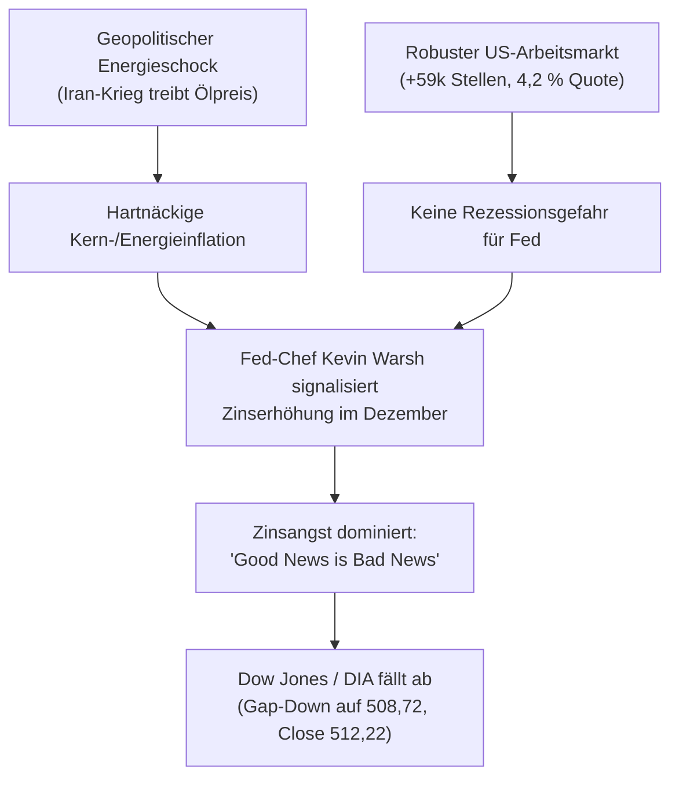

# Regel 4: Zinsangst und das „Good News is Bad News“-Dilemma

---

## 1. Verhaltensnarrativ & Empirischer Befund

Am 06.11.2026 veröffentlichte die US-Regierung solide Arbeitsmarktdaten für Oktober (+59.000 Stellen ex Agrar nach 29.000 im Vormonat, stabile Arbeitslosenquote von 4,2 %, Stundenlöhne +0,3 % gg. Vormonat). Zudem fiel das von der Universität Michigan ermittelte Verbrauchervertrauen stark aus [^news-briefings-2026-11].

In einem klassischen Konjunkturumfeld hätten diese Daten die Märkte beflügelt. Unter den aktuellen Bedingungen trat jedoch das genaue Gegenteil ein:
* **Zinsangst dominiert die Wahrnehmung**: Weil die durch den Iran-Krieg und Angriffe auf iranische Ziele explodierten Energiepreise (Brent zuvor bei bis zu 117 Dollar) die Inflation hoch halten, liefert ein robuster Arbeitsmarkt der Federal Reserve unter Fed-Chef Kevin Warsh freie Hand für eine weitere Leitzinserhöhung im Dezember [^news-briefings-2026-11].
* **Gute Wirtschaftsdaten werden zur Bedrohung**: „Da der Arbeitsmarkt stabil genug dasteht und keine Anzeichen eines Absturzes zeigt, mehren sich die Zeichen für eine erneute Zinserhöhung im Dezember... stützen die soliden Arbeitsmarktdaten die Argumente jener Notenbanker, die eine weitere Zinserhöhung im Dezember befürworten“ [^news-briefings-2026-11].

### Empirischer Beleg am Markt (DIA-ETF)
* **Abwärts-Gap zur Eröffnung**: Am 06.11. eröffnete der DIA bei **508,72** (ein Gap von **-1,08 %** gegenüber dem Vortagsschluss von 514,27) [^dia-market-data].
* **Keine nachhaltige Erholung**: Trotz eines Zwischenanstiegs auf 515,98 fiel der Kurs wieder zurück und schloss bei **512,22** (**-0,40 %**; der Dow Jones Industrial Index verlor -0,46 % auf 51.285 Punkte) [^dia-market-data].
* Das starke Verbrauchervertrauen und die Beschäftigungszahlen ließen die Anleger völlig kalt [^news-briefings-2026-11].

---

## 2. Psychologische Mechanismen

1. **Diskontierungs- und Bewertungsangst**: Höhere risikofreie Zinsen drücken über den Barwert zukünftiger Cashflows direkt auf die Bewertung von Standard- und Dividendenaktien im DJIA.
2. **Kognitive Fokussierung auf den Liquiditätsentzug**: In von Notenbanken dominierten Märkten verliert die fundamentale Unternehmensgesundheit vorübergehend an Bedeutung gegenüber den Finanzierungsbedingungen. Liquidität sticht Wachstum.
3. **Erwartungsumkehr bei Schwellendaten**: Sobald Anleger erwarten, dass die Notenbank jede Konjunkturstärke durch restriktive Geldpolitik neutralisiert, führt jeder positive Datenpunkt zu automatisierten Verkäufen am Aktienmarkt.

---

## 3. Formale OKF-Regeldefinition

> ### Regel 4.1: Das stagflationäre Zinsdilemma
> * **WENN** angebotsseitige Inflationsfaktoren (z. B. kriegsbedingte Rohstoff- und Energiepreissprünge) virulent sind,
> * **UND** die Notenbankführung (Fed) eine Zinserhöhung aktiv als primäres Bekämpfungsmittel vorbereitet,
> * **UND** Konjunktur- oder Arbeitsmarktdaten solide bzw. über den Erwartungen ausfallen,
> * **DANN**:
>   1. Gilt das Paradigma **„Good News is Bad News“**.
>   2. Reagiert der DJIA/DIA mit Zurückhaltung oder Abgaben, insbesondere bei zyklischen und dividendenstarken Industriewerten.
>   3. Kann eine Bodenbildung erst einsetzen, wenn entweder die Zinsfurcht ihren Höhepunkt erreicht hat oder die Zinsen am Anleihemarkt wieder fallen.

---

## 4. Handlungsanweisungen für Anleger & Systeme

1. **Kein automatischer Kauf robuster Wirtschaftsdaten**: Veröffentlichungen von Arbeitsmarktdaten (Non-Farm Payrolls) in einem Zinsanhebungszyklus dürfen nicht als automatisches Kaufsignal interpretiert werden.
2. **Monitoring der Anleiherenditen vor Kassa-Trades**: Kursentscheidungen im DJIA erst nach Feststellung der Reaktion der 10-jährigen US-Staatsanleihen treffen.
3. **Sektorale Umschichtung**: Kapital aus zinssensitiven Dividendenwerten abziehen und in defensiv abgesicherte Liquiditätspositionen lenken.

---

## 5. Querverweise & Provenienz

* Vorherige Regel: [`regel-bull-trap-realitaetsschock`](regel-bull-trap-realitaetsschock.md)
* Folgeregel: [`regel-sektordivergenz-bodenbildung`](regel-sektordivergenz-bodenbildung.md)
* Empirische Daten: [`marktdaten-analyse-dia`](marktdaten-analyse-dia.md)
* Übergeordnete Synthese: [`synthese-verhaltensregeln`](synthese-verhaltensregeln.md)

[^dia-market-data]: Marktdaten-Auszug DJIA/DIA vom 26.10. bis 06.11.2026.
[^news-briefings-2026-11]: Morning Briefings und Schlusspanels der Börse Stuttgart / Dow Jones Newswires vom 06.11.2026.
