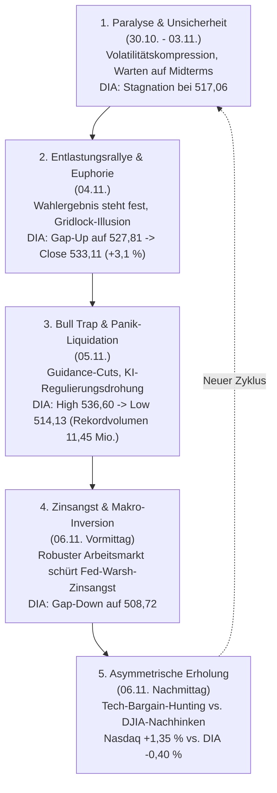
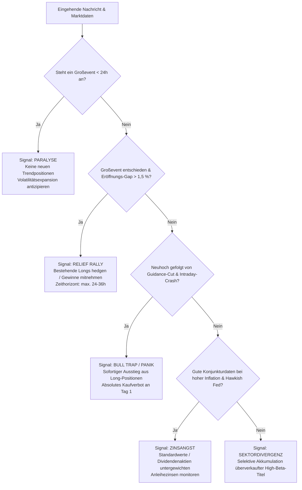

# Gesamtsynthese: Verhaltensökonomisches Marktmodell und Regelsystem

---

## 1. Einordnung des Verhaltenszyklus (Herbst 2026)

Der untersuchte 10-Tages-Ausschnitt des DJIA (abgebildet über den **DIA-ETF** vom 26.10. bis 06.11.2026) liefert ein lehrbuchhaftes Fallbeispiel für das Durchlaufen aller Kernphasen der Marktpsychologie binnen kürzester Zeit [^dia-market-data] [^news-briefings-2026-11]:

---

## 2. Synopse der OKF-Verhaltensregeln

Die folgende Matrix konsolidiert die 5 erarbeiteten OKF-Konzepte in ein anwendbares Regelwerk für automatisierte und diskretionäre Handelsentscheidungen:

| OKF-Regel | Psychologischer Treiber | Empirische Signatur (DIA) | Volumenprofil | Zentrale Handlungsmaxime |
| :--- | :--- | :--- | :--- | :--- |
| [`regel-pre-event-paralyse`](regel-pre-event-paralyse.md) | **Ambiguity Aversion**: Angst vor unkalkulierbaren Richtungsentscheidungen | Handelsspanne < 0,7 %; Eröffnung = Schlusskurs (517,06) | Stark unterdurchschnittlich (< 80 % des Mittels) | **Füße stillhalten**: Keine Ausbruchswetten im illiquiden Markt; Hedges nicht verfrüht auflösen. |
| [`regel-relief-rally-gridlock`](regel-relief-rally-gridlock.md) | **Certainty Relief & Gridlock Bias**: Verwechslung von Gewissheit mit Fundamentalkraft | Massives Gap-Up (+2,08 %), dynamischer Tagestrend (+3,10 %) | Sprunghafter Anstieg (> 150 % des Mittels, 6,6 Mio.) | **Gewinne realisieren**: Pre-Event-Hedges schließen, Longs in die Rallye reduzieren; FOMO-Käufe strikt verbieten. |
| [`regel-bull-trap-realitaetsschock`](regel-bull-trap-realitaetsschock.md) | **Narrative Reversal & Climax Fear**: Schockartiger Zusammenbruch des Hypes | Neues Allzeithoch/Periodenhoch am Morgen (536,60), dann vertikaler Absturz um 22,47 Pkt. | Extremer Rekord-Spike (270 % des Mittels, 11,45 Mio.) | **Notbremse ziehen**: Sofortiger Exit bei Fehlausbruch unter Vortageseröffnung; kein Hineingreifen in fallende Messer. |
| [`regel-zinsangst-good-news-bad-news`](regel-zinsangst-good-news-bad-news.md) | **Monetary Hawkishness**: Furcht vor Liquiditätsentzug überlagert Realwirtschaft | Abwärts-Gap (-1,08 %), Gleichgültigkeit gegenüber robusten Arbeitsmarktdaten | Moderat bis leicht erhöht (ca. 4,0 Mio.) | **Makro-Kontext beachten**: Bei angebotsseitiger Inflation gute Konjunkturdaten nicht unreflektiert als Kaufsignal werten. |
| [`regel-sektordivergenz-bodenbildung`](regel-sektordivergenz-bodenbildung.md) | **Selective Anchoring & Dip-Buying**: Schnäppchenjagd in High-Beta-Wachstumswerten | Dow Jones / DIA stagniert im Minus (-0,40 %), Tech schießt nach oben (+1,35 %) | Selektive Volumenbündelung in Chip- und KI-Werten | **Präzise Allokation**: Rebound-Trades nach Crash-Tagen nicht im breiten DIA, sondern gezielt bei abgestraften Sektorleadern fahren. |

---

## 3. Algorithmischer Entscheidungsbaum

Für die automatisierte Auswertung von Nachrichtenströmen und Kursdaten im Newscheck-System gilt folgendes Entscheidungsdiagramm:

---

## 4. Fazit und Systemnutzen

Durch die Synthese in standardkonforme OKF v0.2 Einheiten steht dem System ein robustes, portables Regelwerk zur Verfügung. Statt Kursbewegungen rein isoliert-technisch oder Nachrichten rein qualitativ zu betrachten, verknüpft das vorliegende Modell die **Ursache-Wirkungs-Beziehung zwischen menschlichem Massenverhalten und tatsächlicher Orderbuchliquidität**.

---

## 5. Provenienz

[^dia-market-data]: Vollständige 10-Tages-Reihe DIA ETF (26.10. – 06.11.2026), analysiert in [`marktdaten-analyse-dia`](marktdaten-analyse-dia.md).
[^news-briefings-2026-11]: Archivierte Morning Briefings der Börse Stuttgart / Dow Jones Newswires (02.11. – 06.11.2026).
